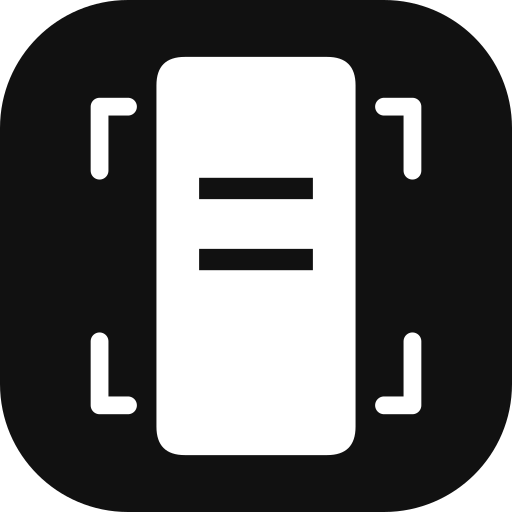
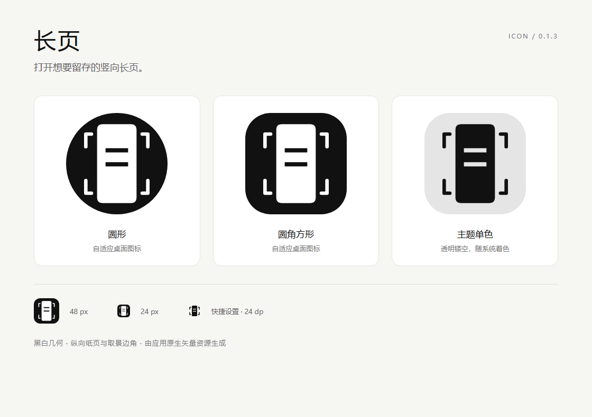

<div align="center">
  
  <h1>长页 · LongPage</h1>
  <p>打开想要留存的竖向长页。</p>
  <p>面向 Android 16 的精简长截图工具 · Java 原生界面 · 本地保存 · MIT</p>
</div>

[](https://github.com/Lawnisomer/longpage/actions/workflows/ci.yml)
[](LICENSE)

## 为什么做长页

这是我的第一个公开项目。起点很具体：为自己的一台手机做一个专注于竖向长截图的小工具，把连续页面完整留下来，同时让功能尽量简单。

项目从选区、截图、滚动和拼接起步，随后处理了超高图像导出、惯性滚动和采集耗时等问题。这里保留实现思路、验证方法和开发过程，方便继续改进，也方便其他人了解它的能力边界。

**当前版本：0.1.3。** 最低及目标版本均为 Android 16 / API 36；真机验证基于 Redmi K70E。其他设备和系统尚未建立兼容性结论。

## 能做什么

- 框选滚动内容，避开固定标题、页码和底栏，并按应用记住选区。
- 向下自动滚动，等待画面稳定，按实际位移匹配接缝。
- 随时暂停、继续或结束；接缝不确定时暂停，保留已采集内容。
- 将新增内容逐块保存到磁盘，再逐行导出完整 PNG 到相册。
- 通过悬浮控制或可选的快捷设置磁贴打开控制入口。
- 图片保存在本机；应用无网络权限、广告或统计 SDK，无第三方运行时依赖。

当前不支持横向翻页、自动切换章节和图片编辑。项目优先保持采集流程简洁。

## 安装与使用

从本仓库的 [Releases](https://github.com/Lawnisomer/longpage/releases) 下载 APK，在 Android 16 手机上安装。

1. 打开“长页”，点“① 启用截图与滚动服务”，在系统设置中启用对应无障碍服务。
2. 返回应用，点“② 显示悬浮控制”，然后打开需要截取的竖向页面。
3. 点“选区”，框住实际滚动区域，避开固定界面元素并确认。
4. 点“开始”，保持目标页面在前台；可随时暂停或结束。
5. 返回长页，点“导出完整 PNG 到相册”。文件位于 `Pictures/LongCapture`。

HyperOS 若提示受限设置，需要由手机使用者在系统应用信息页允许相关设置。截图与自动滚动需要上述用户授权。

画面仍在加载时，等待稳定后再继续。暂停期间大幅手动滚动可能丢失重叠；切换窗口或改变窗口尺寸会停止当前采集并保留已有部分。

## 已有验证

| 项目 | 结果及证据范围 |
| --- | --- |
| 匹配算法 | 7 项 JVM 测试：位移、60% 位移、静止、不相关画面、尺寸异常、有限动态区域、空白页 |
| 合成编号长页 | 28 帧，`1220 × 34362`；46 个完整面板保持 720px 高度，未发现接缝漏行或重复 |
| PNG 导出 | 导出与源条带统一至 sRGB 后，最大 RGB 单通道差为 1 |
| 用户手动长图测试 | 报告 `1220 × 114284` 完整截图及 PNG 导出成功；会话索引确认 146 帧，原内容未公开 |
| 速度优化短测 | 同机、同编号页：约 369px/s → 898px/s，吞吐约 2.43 倍；不能外推为所有页面的固定加速比 |
| 外观 | 桌面、应用信息和快捷设置图标经过真机核对 |

这是一款由单台手机需求起步的早期工具。表中的合成验证、用户反馈和未验证边界分别记录在 [验证报告](VALIDATION.md)，原始汇总数据见 [benchmark.json](docs/benchmark.json)。

## 图标

黑白几何图标以纵向纸页和取景边角表达截图。图标为原生矢量，提供自适应前景、背景及单色层；内容横线使用透明镂空。



## 从源码构建

构建以 **Windows + PowerShell 7 + JDK 21** 为验证环境，不依赖 Gradle 或完整 Android Studio。

安装 Android SDK Command-line Tools 后，准备平台和工具：

```powershell
sdkmanager 'platforms;android-36' 'build-tools;36.0.0' 'platform-tools'
$env:JAVA_HOME = 'C:\Program Files\Java\jdk-21'
$env:ANDROID_HOME = 'C:\Android\Sdk'
./build.ps1 -Test -Release
```

上面两条环境路径需要换成自己的安装位置。输出为 `build/LongCapture.apk`。连接一台已授权 USB 调试的手机后，可加 `-Install` 覆盖安装。

开发调试包使用 `./build.ps1 -Test`；`-Release` 会关闭 `debuggable`。首次本地构建自动创建开发签名，私钥被 Git 忽略。**自己构建的签名通常不同于 Releases，无法直接覆盖使用另一签名安装的版本。**

非标准 SDK 目录、中文路径和自定义签名参数见 [构建指南](docs/BUILDING.md)。

验证仓库内的合成图像样本：

```powershell
python -m pip install -r requirements-dev.txt
python tests/verify_fixture.py
```

Python 和 Pillow 只用于开发验证，不会打包进 Android 应用。GitHub Actions 会执行构建、匹配测试和合成样本校验。

## 阅读源码与开发记录

| 文档 | 内容 |
| --- | --- |
| [架构与设计取舍](docs/ARCHITECTURE.md) | 窗口截图、滚动、稳定检查、接缝匹配、磁盘条带和流式 PNG |
| [开发记录](docs/DEVELOPMENT.md) | 从最小功能到速度优化、图标设计和首次公开整理 |
| [版本记录](CHANGELOG.md) | 各阶段的具体变化 |
| [验证报告](VALIDATION.md) | 如何验证、证据能说明什么、哪些仍未知 |
| [隐私说明](PRIVACY.md) | 授权、截图与会话信息的本地保存方式 |
| [贡献说明](CONTRIBUTING.md) | 如何复现问题、提交改进和准备测试材料 |

代码位于 `app/src/main/java/local/longcapture`。`CaptureService` 管理采集，`OverlapMatcher` 处理位移，`SessionStore` 保存条带，`PngExporter` 导出 PNG。包名 `local.longcapture` 和导出目录保留原有命名，便于现有安装继续使用。

单次资源保护边界为 500 帧、逻辑高度 1,000,000px、已保存分块约 512MiB，剩余空间不足 100MiB 时停止。它们是保护阈值，不是已验证的容量保证；不同相册和分享应用也可能限制长图尺寸。

## 开源与致谢

本项目按 [MIT License](LICENSE) 开源。应用使用 Android 平台 API 和 Java 标准库；开发验证依赖 Pillow，构建依赖 Android SDK 与 JDK。

需求取舍和真机使用反馈由项目作者提供，代码、文档与验证流程使用 Codex 辅助完成。公开历史从当前整理后的快照开始，早期版本记录由实际开发和已保存的验证结果整理，不伪造早期 Git 提交。

技术接口参考：[AccessibilityService](https://developer.android.com/reference/android/accessibilityservice/AccessibilityService)、[连续手势](https://developer.android.com/reference/android/accessibilityservice/GestureDescription.StrokeDescription)、[自适应图标](https://developer.android.com/develop/ui/compose/system/icon_design_adaptive)。
