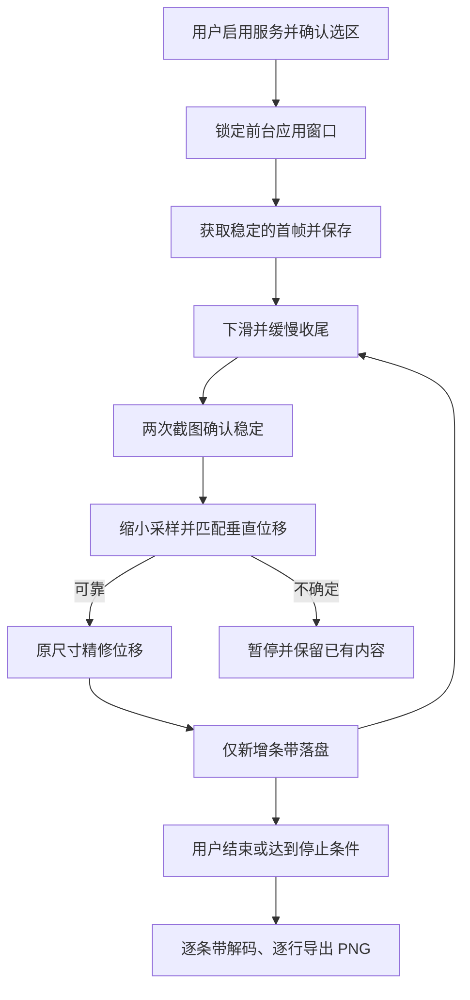

# 架构与设计取舍

## 一次采集的数据流

## 界面、线程与窗口

界面由 Java 原生 View 构成，包含服务引导、悬浮控制、选区和最近一次任务。主线程处理界面、截图回调和手势；单个后台执行器串行处理采集。导出由独立后台线程完成，避免阻塞主界面。

应用通过无障碍服务获取前台窗口 ID 和边界，再使用 `takeScreenshotOfWindow`。窗口截图使控制浮层不会进入目标图像。开始后锁定目标窗口；窗口或尺寸变化时结束，避免把不同页面混入一次任务。

选区以相对于窗口的四个比例保存，按目标包区分。它表达内容区域，不尝试自动识别所有应用的标题或工具栏。

## 稳定检查与滚动

首次采集前等待 450ms；后续滚动后等待 140ms，再比较两张间隔约 440ms 的截图。80 × 144 灰度采样的平均差小于 1.35 时视为稳定，最多比较五次；仍不稳定则暂停。截图另有 430ms 的调用间隔限制。

手势从选区高度的 84% 移到 24%，拖动 450ms，随后用 180ms 缓慢移动约 1px 再抬起。保留约 40% 画面供接缝匹配。极慢收尾为阅读器提供减速事件，减少快速拖动后的惯性；实际效果仍与目标页面的滚动实现有关。

## 接缝匹配

`OverlapMatcher` 不依赖 Android，可直接在 JVM 上测试。采样宽度 160、最高 560 行，搜索不超过约 76% 高度的垂直位移。

评分把重叠区域划为 24 个块，结合灰度与垂直边缘差，忽略误差最大的 4 块以容纳有限动态内容。最优误差与相邻候选的区分度共同决定可信度；不可靠时暂停，不按预估滚动距离直接追加。

可信结果再在原图纵向分辨率上小范围精修，只保存当前帧底部新增部分。连续两轮画面没有移动时停止。重复纹理、纯色或大范围动画仍可能削弱判断，因此合成测试不能替代所有真实页面验证。

## 磁盘条带与 PNG

每个会话包含独立 PNG 条带与 `manifest.json`，索引记录宽、高、累计字节数、分块名称、目标包名和停止原因。索引通过临时文件、同步及原子重命名更新，以减少中断写入导致索引损坏的风险。

导出不创建整张超高 Bitmap：一次解码一个条带，逐行读取 RGB，通过 Deflater 和 64KiB IDAT 分块写出 PNG。写入系统 MediaStore 时先标记为待完成，成功后发布；失败则删除未完成的导出项，原条带保留供重试。

这减少了内存随最终图片高度增长的问题，但仍需容纳当前截图、相邻帧和一个导出条带。最高内存峰值尚无系统化测量结论。

## 为什么保持简单

- 原生 Java 与平台 API 满足当前单机需求，避免引入额外 UI 或运行时依赖。
- 串行采集让截图、手势和条带顺序容易理解；先优化滚动距离与等待时间，而非同时处理多个采集任务。
- 暂停优先于猜测接缝，保留部分结果比继续累积错误更有用。
- 图片编辑、账号、云同步和跨章节导航未进入当前功能范围。

调试版含应用私有文件命令入口，供开发者通过已授权的 ADB `run-as` 使用；非调试包不会启动其轮询。发布源码与调试包并不改变手机对无障碍授权的要求。
