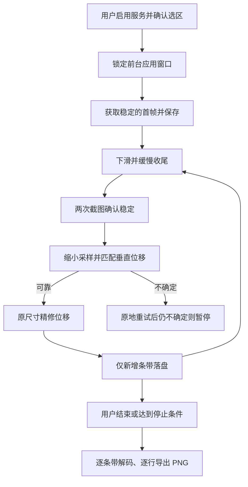

# 架构与设计取舍

## 一次采集的数据流

## 界面、线程与窗口

界面由 Java 原生 View 构成，包含服务引导、悬浮控制、选区和最近一次任务。主线程处理界面、截图回调和手势；单个后台执行器串行处理采集。导出由独立后台线程完成，避免阻塞主界面。

应用通过无障碍服务获取前台窗口 ID 和边界，再使用 `takeScreenshotOfWindow`。窗口截图使控制浮层不会进入目标图像。开始后锁定目标窗口；窗口或尺寸变化时结束，避免把不同页面混入一次任务。

选区以相对于窗口的四个比例保存，按目标包区分，已有手动选区优先。该包完全没有保存区域时，可用可见滚动容器与默认区域的交集临时收窄截图：交集宽度至少为默认区域的 90%、高度至少为 75%，且不写入配置。它不尝试识别所有标题、吸顶栏或工具栏，用户仍需确认正文选区。

## 稳定检查与滚动

首次采集前等待 450ms；后续滚动后等待 140ms，再比较两张间隔约 440ms 的截图。80 × 144 灰度采样划成 48 个空间块，忽略差异最大的 6 块后，其余块平均差小于 1.35 时视为稳定。每次最多比较五次，再有限次数原地重试；仍不稳定则暂停。该门槛只判断何时尝试接缝匹配，不直接允许追加。截图另有 430ms 的调用间隔限制，过短错误可重试一次。

0.1.6 的正常手势从有效滚动区域高度的 80% 移到 40%，拖动 450ms，随后用 180ms 缓慢移动约 1px 再抬起。相较 0.1.5 的 84% → 24%，单次拖动由约 60% 缩短至 40%，理论重叠增至约 60%。本轮保留原拖动时间；实际位移与惯性仍由目标页面的滚动实现决定。

0.1.6 的顶部屏蔽修订默认将选区顶部 10%（向上取整到采样行）排除出稳定、静止、粗细匹配和原像素精修。比较点重新分布在剩余正文或有效重叠区中，但原始图像和坐标高度保持不变，避免缩放位移换算错误。首帧保存完整选区，后续只追加底部新增条带；屏蔽不会直接裁掉正文。导航栏超出该范围或正文证据不足时仍可能暂停。

手势优先落在选区内的可见滚动容器；暂停或结束会等当前手势释放再响应。等待截图、稳定采样和重试间隔期间每约 100ms 检查控制状态；恢复后在原地重新取帧，不跳过尚未确认的接缝。

## 接缝匹配

`OverlapMatcher` 不依赖 Android，可直接在 JVM 上测试。先以宽度 160、最高 560 行的采样搜索不超过有效正文高度约 76% 的垂直位移，以保留至少约 24% 的正文重叠。不可信且并非静止时，可原地再用最高 1120 行采样判断一次；每块纵向采样密度随高度增长，防止落入稀疏文字的行间空白。两种采样沿用相同可信度规则。

评分把有效重叠区域划为 24 个块，结合灰度与垂直边缘差，排除缺乏纹理的块。至少需要 6 个低误差块，跨 3 个纵向分区和 2 个横向分区支持同一位移，并要求最优结果与其他候选具有区分度；固定有纹理底栏另作否定检查。静止判断要求屏蔽带以下正文近乎一致，不能用忽略局部变化后的平移评分替代。重复评论、空白或大面积动画仍可能缺乏可靠证据。

可信结果再在原图纵向分辨率上小范围精修，只保存当前帧底部新增部分。不确定接缝最多原地重试两次，再暂停保留任务；期间不继续滚动。未移动先原地复核，再最多两次轻滑尝试，仍不移动则停止并提示可能到底或滚动未响应。因此合成测试不能替代所有真实页面验证。

## 磁盘条带与 PNG

每个会话包含独立 PNG 条带与 `manifest.json`，索引记录宽、高、累计字节数、分块名称、目标包名和停止原因。索引通过临时文件、同步及原子重命名更新，以减少中断写入导致索引损坏的风险。

导出不创建整张超高 Bitmap：一次解码一个条带，逐行读取 RGB，通过 Deflater 和 64KiB IDAT 分块写出 PNG。写入系统 MediaStore 时先标记为待完成，成功后发布；失败则删除未完成的导出项，原条带保留供重试。

这减少了内存随最终图片高度增长的问题，但仍需容纳当前截图、相邻帧和一个导出条带。最高内存峰值尚无系统化测量结论。

## 为什么保持简单

- 原生 Java 与平台 API 满足当前单机需求，避免引入额外 UI 或运行时依赖。
- 串行采集让截图、手势和条带顺序容易理解；先优化滚动距离与等待时间，而非同时处理多个采集任务。
- 暂停优先于猜测接缝，保留部分结果比继续累积错误更有用。
- 图片编辑、账号、云同步和跨章节导航未进入当前功能范围。

调试版含应用私有文件命令入口，供开发者通过已授权的 ADB `run-as` 使用；非调试包不会启动其轮询。发布源码与调试包并不改变手机对无障碍授权的要求。
